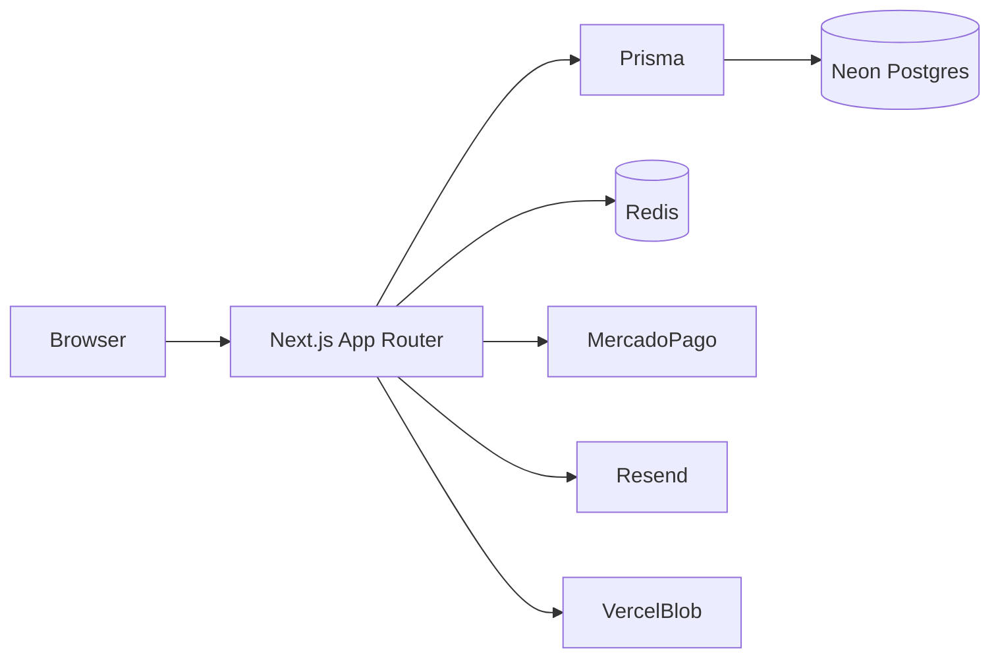

# Aura Pro

E-commerce de hardware gamer (proyecto de portafolio). Un solo runtime: **Next.js 16 (App Router) + TypeScript** sirve la UI y las Route Handlers en `/api`, con **Prisma + PostgreSQL (Neon)**.

**Demo:** [pagina-web-ventapc.vercel.app](https://pagina-web-ventapc.vercel.app) · **Repo:** [github.com/CrisNeyra/pagina-web-ventapc](https://github.com/CrisNeyra/pagina-web-ventapc)

### Para reclutadores

| Área | Implementación |
|------|----------------|
| Stack | Next.js 16, React 19, TypeScript, Tailwind v4, Zustand |
| API | Route Handlers en `src/app/api` (mismo origen / mismo deploy) |
| Datos | Prisma + PostgreSQL (Neon) |
| Auth | JWT + cookie httpOnly `aura_token` (no va a `localStorage`) |
| Pagos | Checkout Pro (Mercado Pago) + efectivo / transferencia |
| Tests | Vitest (unit) + Playwright (e2e) |
| Observabilidad | `GET /api/health`, Sentry opcional |
| Deploy | Vercel + Neon (+ Redis rate limit, Resend, Vercel Blob) |

---

## Arquitectura



**Decisiones:**

- Un runtime: UI y API en Next; no hace falta un backend aparte en el día a día.
- Sesión en cookie httpOnly; el JWT no se guarda en el cliente.
- Nest (`api/`) está archivado como referencia. En producción **no** se setea `NEXT_PUBLIC_API_URL`.

---

## Recorridos

- Catálogo, búsqueda, carrito y checkout (retiro/envío × efectivo, transferencia o Mercado Pago)
- **Armá tu PC** (compatibilidad de componentes y persistencia del build)
- Área de usuario (`/usuario`) y panel admin (`/admin`)
- Postulaciones RRHH con CV (Vercel Blob en prod)
- Salud del sistema: [`/api/health`](https://pagina-web-ventapc.vercel.app/api/health)

---

## Local

1. Proyecto en [Neon](https://console.neon.tech) → copiá `DATABASE_URL`.
2. En la raíz:

```bash
npm install
cp .env.local.example .env.local
# DATABASE_URL, JWT_SECRET, ADMIN_EMAIL, ADMIN_PASSWORD
npm run db:setup
npm run dev
```

Mínimo en `.env.local`: `DATABASE_URL`, `JWT_SECRET`. El resto (Mercado Pago, Google, Redis, Resend, Blob, Sentry) está comentado en [`.env.local.example`](.env.local.example).

Si `npm run dev` deja de responder, paralo, borrá `.next` y volvé a levantar.

### Scripts

| Comando | Descripción |
|--------|-------------|
| `npm run dev` | App local (UI + `/api`) |
| `npm run build` / `npm start` | Build y servidor de producción |
| `npm run db:setup` | Migraciones + seed |
| `npm run lint` | ESLint |
| `npm run test` | Vitest |
| `npm run test:e2e` | Playwright (build + Chromium) |
| `npm run test:e2e:ui` | Playwright UI |

---

## Docs

| Tema | Archivo |
|------|---------|
| Stack | [`docs/stack-next-prisma-neon.md`](docs/stack-next-prisma-neon.md) |
| Deploy Vercel | [`docs/vercel-produccion.md`](docs/vercel-produccion.md) |
| Mercado Pago | [`docs/mercadopago.md`](docs/mercadopago.md) |
| Seguridad | [`docs/seguridad-api.md`](docs/seguridad-api.md) |
| Observabilidad | [`docs/observabilidad.md`](docs/observabilidad.md) |
| ADR | [`docs/adr-001-arquitectura.md`](docs/adr-001-arquitectura.md) |

---

## Licencia

Proyecto educativo / portafolio.

La carpeta `api/` (Nest) queda como referencia histórica. No forma parte del flujo diario ni del deploy en Vercel. Guías: [`docs/api-backend.md`](docs/api-backend.md), [`api/README.md`](api/README.md).
